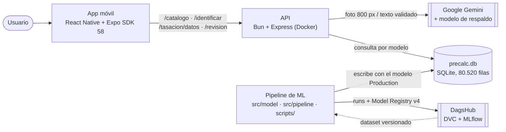
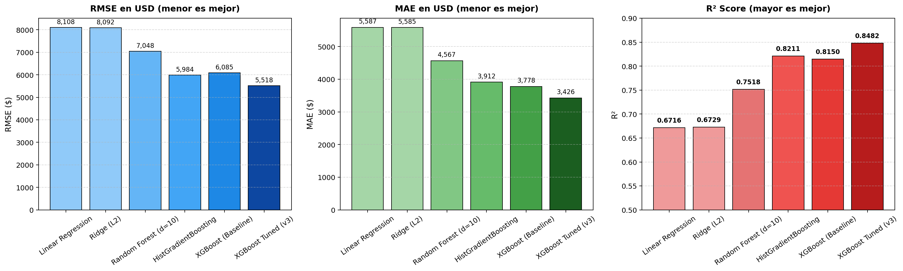
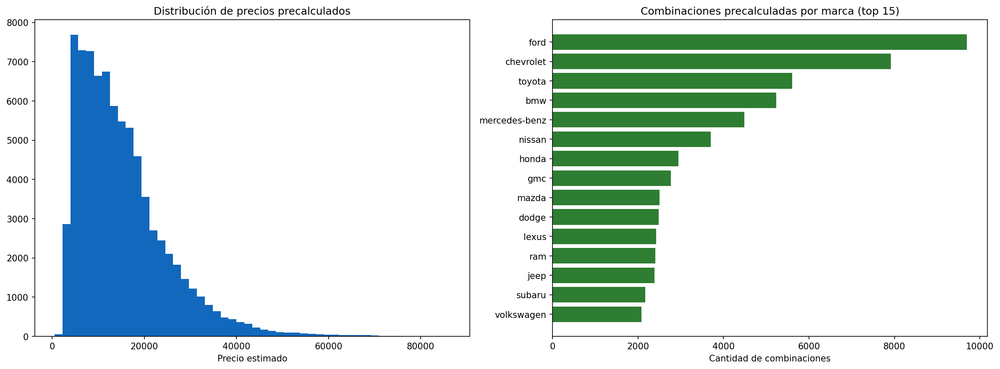

# ValorAuto

Tasador de autos con IA: ingresa los datos de un auto o sube una foto, y obtén su precio de mercado estimado, el rango esperado y las fallas comunes que conviene revisar antes de comprarlo.

**Curso:** Taller de Sistemas Inteligentes — LAB_01 (SIS-352), UCB
**Equipo:** Marvin Mollo Ramírez, Leonardo Delgado, Samuel Villca
**Estado:** MVP integrado para la **2.ª defensa (EC2)**: app, API, componente inteligente y pipeline de ML funcionando de punta a punta con Docker Compose.
**Gestión:** backlog y tareas en [ClickUp](https://app.clickup.com/90171461819/v/s/90176873612) · riesgos en [`docs/risk-register.md`](docs/risk-register.md) · plan B de la demo en [`docs/plan-b-demo.md`](docs/plan-b-demo.md)

## Qué hace

1. **Dos formas de tasar** desde la app móvil (React Native + Expo):
   - **Ingresar datos:** marca, modelo, año y kilometraje.
   - **Usar una foto:** Gemini identifica marca, modelo y año y **prellena el formulario**; el usuario corrige si hace falta y completa el kilometraje.
2. **Precio de mercado** en milisegundos: no se calcula en el momento. Un modelo XGBoost entrenado sobre 352.005 anuncios reales deja precalculadas 80.520 combinaciones (marca + modelo + año + tipo + kilometraje) en SQLite, y la API solo las lee ([ADR-0003](docs/adr/0003-precalculo-nocturno-vs-tiempo-real.md)).
3. **Fallas comunes y qué revisar primero** para ese modelo, generadas con Gemini en modo texto, con un checklist genérico de respaldo ([ADR-0011](docs/adr/0011-gemini-checklist-inspeccion.md)).

Gemini **nunca** da precios: solo identifica el auto y redacta la revisión ([ADR-0004](docs/adr/0004-gemini-vision-vs-modelo-propio.md)). El precio sale 100 % del modelo propio.

**Problema:** tasar un auto usado en Bolivia hoy depende de buscar a mano en catálogos y clasificados, sin una referencia rápida y confiable. Detalle del Product Goal, alcance y backlog en [`docs/contexto/contexto_proyecto.md`](docs/contexto/contexto_proyecto.md). Metodología: CRISP-ML(Q) ([`docs/crisp-mlq.md`](docs/crisp-mlq.md)).

## Arquitectura

Vista simplificada (C4 completo y secuencia en [`docs/architecture/`](docs/architecture/C4-ValorAuto.md)):



| Capa | Tecnología | Dónde | ADR |
|---|---|---|---|
| App móvil | React Native + Expo SDK 58 (Expo Go) | [`app/`](app/) | [0002](docs/adr/0002-frontend-react-native-expo.md) |
| API | Bun + Express, Zod, multer + sharp, pino, Swagger | [`src/api/`](src/api/) | [0001](docs/adr/0001-backend-nodejs-express.md) |
| Componente generativo | Google Gemini (visión + texto) | [`src/api/services/gemini.service.js`](src/api/services/gemini.service.js) | [0004](docs/adr/0004-gemini-vision-vs-modelo-propio.md), [0011](docs/adr/0011-gemini-checklist-inspeccion.md), [0012](docs/adr/0012-exclusion-rag-y-agentes.md) |
| Modelo de precio | XGBoost + `model_base` (Scikit-Learn pipeline) | [`src/model/`](src/model/) | [0009](docs/adr/0009-features-condition-cylinders-size.md), [0010](docs/adr/0010-model-base-feature-y-busqueda-por-modelo.md) |
| Precálculo | SQLite `data/precalc.db` | [`src/pipeline/`](src/pipeline/) | [0003](docs/adr/0003-precalculo-nocturno-vs-tiempo-real.md), [0007](docs/adr/0007-sqlite-lectura-rapida.md) |
| Tracking / Registry | MLflow en DagsHub | [`scripts/sync_dagshub_model.py`](scripts/sync_dagshub_model.py) | [0005](docs/adr/0005-mlflow-tracking-model-registry.md) |
| Datos versionados | DVC + DagsHub | [`data/`](data/) | [0006](docs/adr/0006-dvc-dagshub-versionamiento-datos.md) |
| Contenedores | Docker Compose (`api`, `mlflow`, `training`, `test-ml`) | [`docker-compose.yml`](docker-compose.yml) | — |

## Cómo ejecutarlo

### Requisitos
- Docker Desktop.
- Node.js 20 o más nuevo (para la app y el E2E).
- DVC (`pip install dvc`) con acceso a DagsHub.
- **Expo Go (SDK 58)** en el teléfono, en la misma red Wi-Fi que la computadora.

### 1. Código y datos
```bash
git clone https://github.com/MarvinMR24/ValorAuto.git
cd ValorAuto
dvc pull data/vehicles/vehicles_clean.csv.dvc        # dataset limpio (352.005 filas)
```
Si DVC pide autenticación, ver la [nota de acceso](#acceso-a-dagshub).

### 2. Configuración y secretos
```bash
cp .env.example .env        # completar: GEMINI_API_KEY, MLFLOW_TRACKING_URI/USERNAME/PASSWORD (token de DagsHub)
```
Variables del API y sus valores vigentes: [`src/api/.env.example`](src/api/.env.example). Usa `BASELINE_MAE=3243` (MAE del modelo vigente). El `.env` nunca se commitea.

### 3. Base de precios (`data/precalc.db`)
No se versiona en git: se genera desde el dataset. Elige una opción:
```bash
docker compose build training
# Entrena, registra en MLflow (DagsHub) como Production y genera precalc.db con ese mismo modelo:
docker compose run --rm training python3 -m scripts.sync_dagshub_model
# Sin tocar MLflow (solo regenera precalc.db localmente):
docker compose run --rm training python3 scripts/recalc_precalc_db.py
```

### 4. Backend
```bash
docker compose up -d --build api
docker compose ps                      # valorauto-api → healthy
scripts/smoke_test.sh                  # verificación rápida del despliegue (ver "Pruebas")
```
API en `http://localhost:3000`, Swagger en `http://localhost:3000/docs`, estado en `/health`. Tras regenerar `precalc.db`: `docker compose restart api`.

### 5. App en el teléfono
```bash
ipconfig getifaddr en0                 # IP de la computadora en la red local (macOS)
cd app
npm install
echo "EXPO_PUBLIC_API_URL=http://<esa-IP>:3000" > .env
npx expo start -c                      # escanear el QR con Expo Go
```
Detalle en [`app/README.md`](app/README.md). Si algo falla en la demo: [`docs/plan-b-demo.md`](docs/plan-b-demo.md).

### Otros servicios
```bash
docker compose up mlflow                              # UI de MLflow local en http://localhost:5001
docker compose run --rm training                      # pipeline completo con notebooks (01_eda → 02_entrenamiento → 03_precalculo)
```

## Pruebas

| Nivel | Qué valida | Comando | Resultado (2026-10-26) |
|---|---|---|---|
| Unitarias + integración (API) | Validaciones, errores 400/404/422/429/503, búsqueda en SQLite, caché, modelo de respaldo de Gemini, optimización de imágenes, **seguridad** (prompt injection, filtro de precios, lista blanca de campos, Helmet) | `docker run --rm -v "$PWD/src/api":/src:ro oven/bun:1.4.4 sh -c "cp -r /src /w && cd /w && bun install --frozen-lockfile --ignore-scripts >/dev/null && bun test"` | **64/64** |
| Unitarias (ML) | Configuración de features, limpieza, combinaciones, piso de precio, escritura atómica, esquema de `precalc.db` | `docker compose --profile tools run --rm test-ml` | **26/26** |
| E2E | App real (build web) → API → precalc.db → resultado en pantalla; foto real → Gemini → precio → revisión | `cd tests/e2e && npm install && npx playwright install chromium && npm run build:app && npm test` | **4/4** |
| Smoke | Despliegue levantado: salud, catálogo, tasación, revisión y errores | `scripts/smoke_test.sh [URL]` (con foto real: `CON_GEMINI=1 scripts/smoke_test.sh`) | **OK** |
| Golden set (IA generativa) | Exactitud de Gemini sobre 28 fotos etiquetadas (marca, modelo, año, 422/503, latencia) | `docker compose --profile tools run --rm test-ml python tests/golden_set/evaluar_golden_set.py` | marca+modelo **100 %**, año ±1 **82 %** |

Detalle de las pruebas E2E en [`tests/e2e/`](tests/e2e/). Con Node 26, el E2E necesita Playwright 1.63 (ya fijado en su `package.json`).

## Resultados del modelo

Detalle completo, gráficos y experimentos descartados en [`docs/evidence/baseline-modelo.md`](docs/evidence/baseline-modelo.md). Mismo split 80/20 (`RANDOM_SEED=42`, 281.604 train / 70.401 test):

| Modelo | RMSE (USD) | MAE (USD) | R² | Estado |
|---|---|---|---|---|
| Linear Regression (línea base) | 8.107,91 | 5.587,19 | 0,6716 | Descartado |
| Random Forest | 7.048,09 | 4.566,73 | 0,7518 | Descartado |
| XGBoost (10 features, ADR-0009) | 6.085,26 | 3.777,90 | 0,8150 | Production anterior |
| XGBoost v3 (profundidad 9) | 5.798 | 3.563 | 0,8320 | Re-medido; superado |
| **XGBoost v3 + `model_base`** (ADR-0010) | **5.301,16** | **3.243,42** | **0,8596** | **Production — `ValorAuto_Model` v4 en DagsHub** |

Experimentos que no mejoraron y quedaron documentados: `cylinders` numérico en vez de categórico (ADR-0009), `model` crudo con 20.439 categorías (ADR-0010). MLflow: run `a59552af758a44b38b425585bce8c3f9` en [DagsHub](https://dagshub.com/SNARF3/ValorAutoData.mlflow).

<table>
<tr>
<td></td>
<td></td>
</tr>
</table>

**Limitaciones declaradas** (ver el [risk register](docs/risk-register.md)):
- El dataset es del mercado de EE. UU., no del boliviano (R2).
- Gemini acierta marca y modelo en 28/28 fotos del golden set, pero el **año** solo en el 82 % con ±1 año, y su confianza no avisa cuándo se equivoca: por eso el formulario es editable ([evaluación](docs/evidence/golden-set-vision.md), R3/R21).

## Estructura

- [`app/`](app/): app móvil (pantallas, componentes, cliente HTTP).
- [`src/api/`](src/api/): API REST (rutas, controllers, middlewares, services, tests).
- [`src/model/`](src/model/), [`src/pipeline/`](src/pipeline/): limpieza, features, entrenamiento, evaluación y precálculo.
- [`scripts/`](scripts/): registro en MLflow, precálculo, reentrenamiento nocturno y `smoke_test.sh`.
- [`notebooks/`](notebooks/): notebooks delgados que orquestan `src/` ([ADR-0008](docs/adr/0008-separacion-componentes-notebooks-delgados.md)).
- [`tests/`](tests/): pruebas de ML (pytest) y [`tests/e2e/`](tests/e2e/) (Playwright).
- [`openspec/`](openspec/): contratos versionados (`endpoint-tasacion-mvp`, `app-dos-flujos-tasacion`).
- [`docs/`](docs/): arquitectura, ADRs (0001–0012), riesgos, evidencias, plan B y uso de IA.

## Documentación

- [`docs/architecture/C4-ValorAuto.md`](docs/architecture/C4-ValorAuto.md) y [`secuencia-tasacion.md`](docs/architecture/secuencia-tasacion.md): arquitectura vigente.
- [`docs/adr/`](docs/adr/): decisiones de arquitectura, incluidas las exclusiones (RAG/agentes).
- [`docs/risk-register.md`](docs/risk-register.md): riesgos y limitaciones (R1–R25).
- [`docs/plan-b-demo.md`](docs/plan-b-demo.md): checklist previo y plan B de la demo.
- [`docs/evidence/`](docs/evidence/): línea base del modelo e implementación del backend.
- [`docs/team_charter.md`](docs/team_charter.md), [`docs/clickup_estructura.md`](docs/clickup_estructura.md), [`docs/uso-ia.md`](docs/uso-ia.md).

## Acceso a DagsHub

Remoto de datos y MLflow: `https://dagshub.com/SNARF3/ValorAutoData` ([ADR-0006](docs/adr/0006-dvc-dagshub-versionamiento-datos.md)). Si `dvc pull` falla por autenticación, configura tu token localmente (nunca se commitea):

```bash
dvc remote modify origin --local auth basic
dvc remote modify origin --local user <tu-usuario-dagshub>
dvc remote modify origin --local password <tu-token-dagshub>
```
