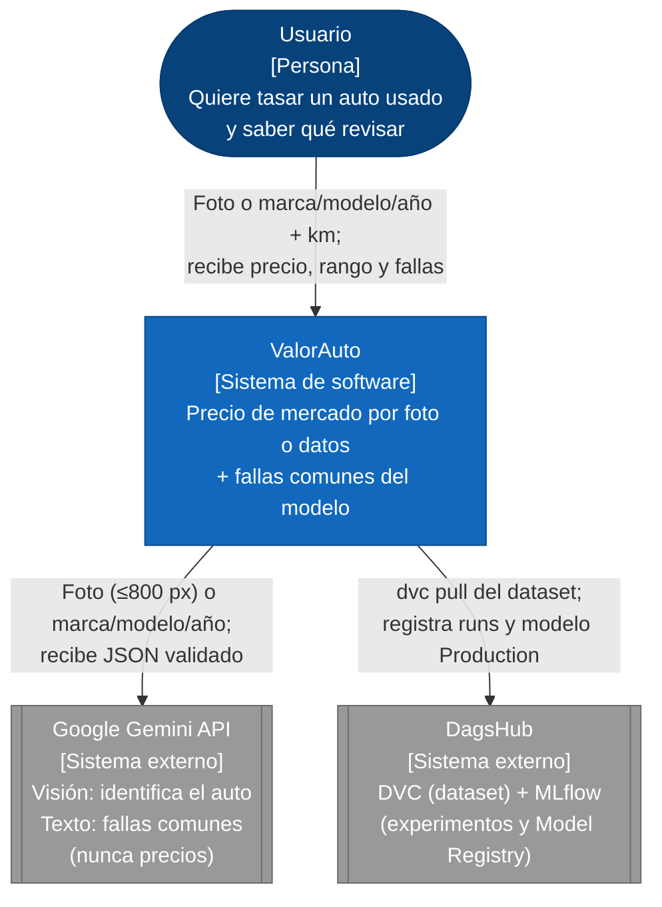
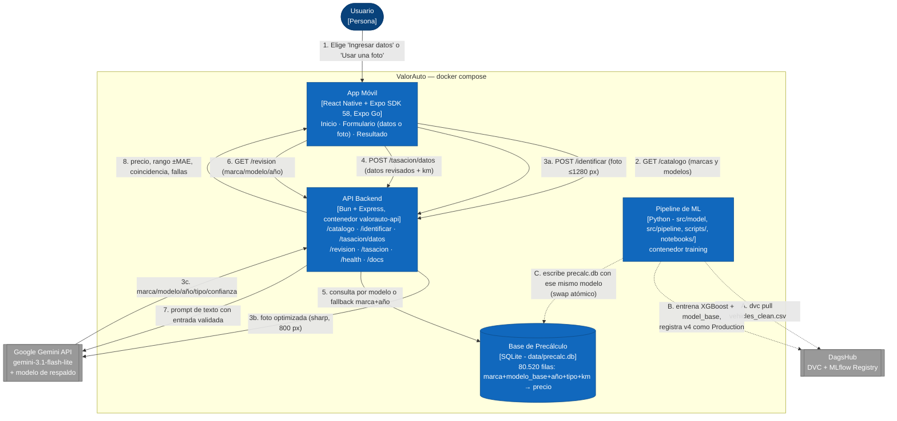
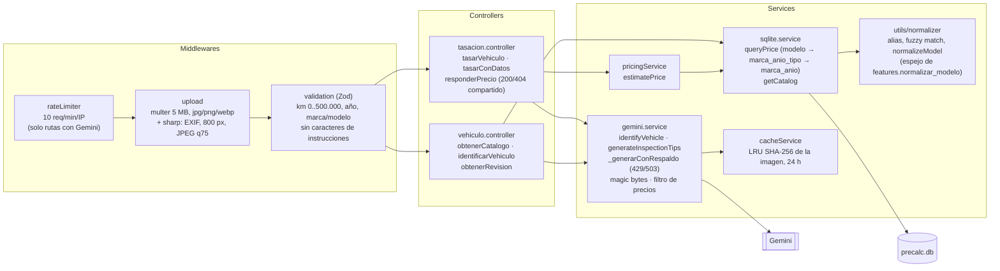
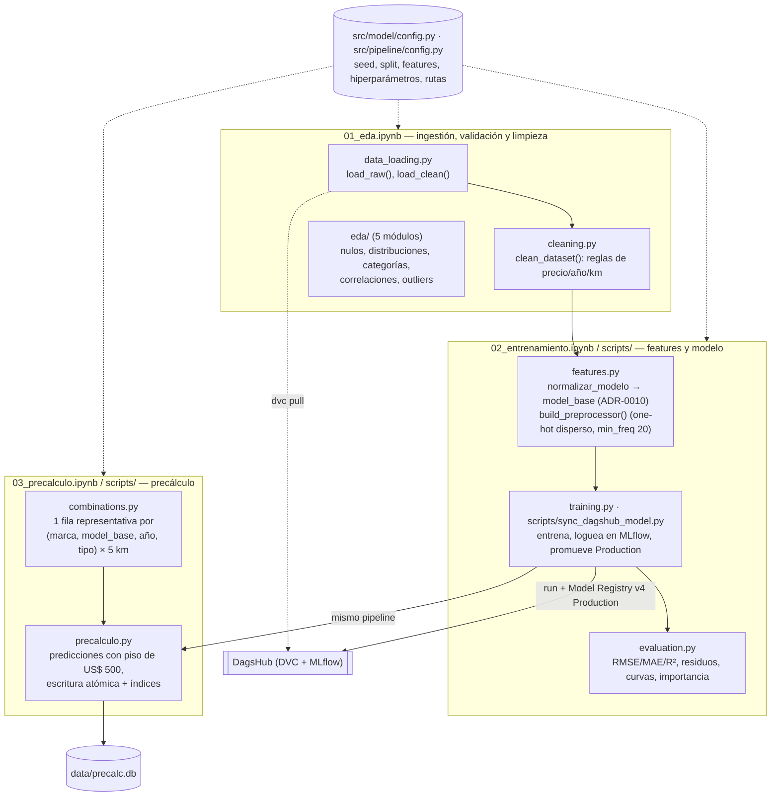

# Arquitectura C4 — ValorAuto

Diagramas C4 (Contexto, Contenedores y Componentes) del Tasador de Autos con IA, **actualizados al estado real del MVP en la 2.ª defensa (2026-10-26)**: lo que aparece acá existe en el código y corre en la demo. Lo que todavía no existe se marca como tal.

> Los diagramas vigentes son los Mermaid de este archivo (GitHub los renderiza). `valorauto-c4-container.xml` (draw.io) y `img/*.png` son la **versión de septiembre (Sprint 2)**: se conservan como historial y ya no reflejan los endpoints de la app, el modelo de respaldo ni la búsqueda por modelo.

## Nivel 1 — Contexto del sistema

## Nivel 2 — Contenedores

Dos flujos: la **tasación en línea** (síncrona, líneas continuas) y el **pipeline de ML** (asíncrono, líneas punteadas), que deja el precio precalculado para que la consulta en vivo nunca espere a un modelo.

**Lo que todavía no existe:** el pipeline se ejecuta a demanda (`docker compose run --rm training …`). `scripts/nightly_retrain.py` implementa la corrida nocturna con detección de cambios del dataset, pero **no hay ningún servidor 24/7 con cron** que la dispare (ver `scripts/README.md`). Tampoco hay despliegue en la nube: el MVP corre con Docker Compose en una máquina del equipo (R25).

## Nivel 3 — Componentes del API Backend (`src/api`)

## Nivel 3 — Componentes del Pipeline de ML

## Componentes y responsabilidad

| Componente | Tecnología | Responsabilidad | Evidencia |
|---|---|---|---|
| App Móvil | React Native + Expo SDK 58 | Dos flujos ("Ingresar datos" y "Usar una foto") que terminan en la misma pantalla de resultado: precio, rango y fallas comunes. Achica la foto a 1280 px antes de subirla. | `app/`, E2E `tests/e2e/app.spec.mjs` |
| API Backend | Bun + Express (contenedor) | Valida la entrada, orquesta Gemini y la consulta a `precalc.db`, maneja errores (400/404/422/429/503) y expone el contrato público. | `src/api/`, Swagger en `/docs`, 64 tests |
| Servicio de visión y texto | Google Gemini (externo) | Identifica el vehículo por foto y genera fallas comunes. **Nunca da precios** (ADR-0004, ADR-0011): prompt, validación de esquema y filtro de salida. | `gemini.service.js`, `test/seguridad.test.js` |
| Base de Precálculo | SQLite `data/precalc.db` | Combinación → precio, con índices por modelo y por marca+año. La regenera el pipeline (no se versiona en git, R20). | `sqlite.service.js` |
| Pipeline de ML | Python (`src/model`, `src/pipeline`, `scripts/`, `notebooks/`) | Ingestión, limpieza, features (`model_base`), entrenamiento (XGBoost v3), evaluación y precálculo reproducibles. | 26 tests pytest, `docs/evidence/baseline-modelo.md` |
| MLflow + DVC | DagsHub | Dataset versionado (DVC). Experimentos y Model Registry: `ValorAuto_Model` **v4 Production** (R² 0.8596, MAE 3.243). | run `a59552af758a44b38b425585bce8c3f9` |

## Configuración y secretos

| Qué | Dónde | Versionado |
|---|---|---|
| Código | `src/`, `app/`, `scripts/`, `tests/` | Sí |
| Configuración por defecto | `src/api/config/config.js`, `src/model/config.py`, `docker-compose.yml` | Sí |
| Plantillas de variables | `.env.example`, `src/api/.env.example`, `app/.env.example` | Sí |
| Secretos (`GEMINI_API_KEY`, token de DagsHub) | `.env` en la raíz | **No** (`.gitignore`) |
| IP local de la app | `app/.env` | **No** |
| Datos generados (`precalc.db`, `mlflow.db`) | `data/`, raíz | **No** (se regeneran) |

## Decisiones que sustentan este diagrama

Cada elección tiene su ADR en [`docs/adr/`](../adr/) (0001–0012). Las más recientes:
- [ADR-0010](../adr/0010-model-base-feature-y-busqueda-por-modelo.md): `model_base` como feature y clave de búsqueda.
- [ADR-0011](../adr/0011-gemini-checklist-inspeccion.md): Gemini para el checklist de inspección.
- [ADR-0012](../adr/0012-exclusion-rag-y-agentes.md): por qué no se usa RAG ni agentes.

Los riesgos están en [`docs/risk-register.md`](../risk-register.md). La secuencia detallada de la tasación está en [`secuencia-tasacion.md`](secuencia-tasacion.md).
