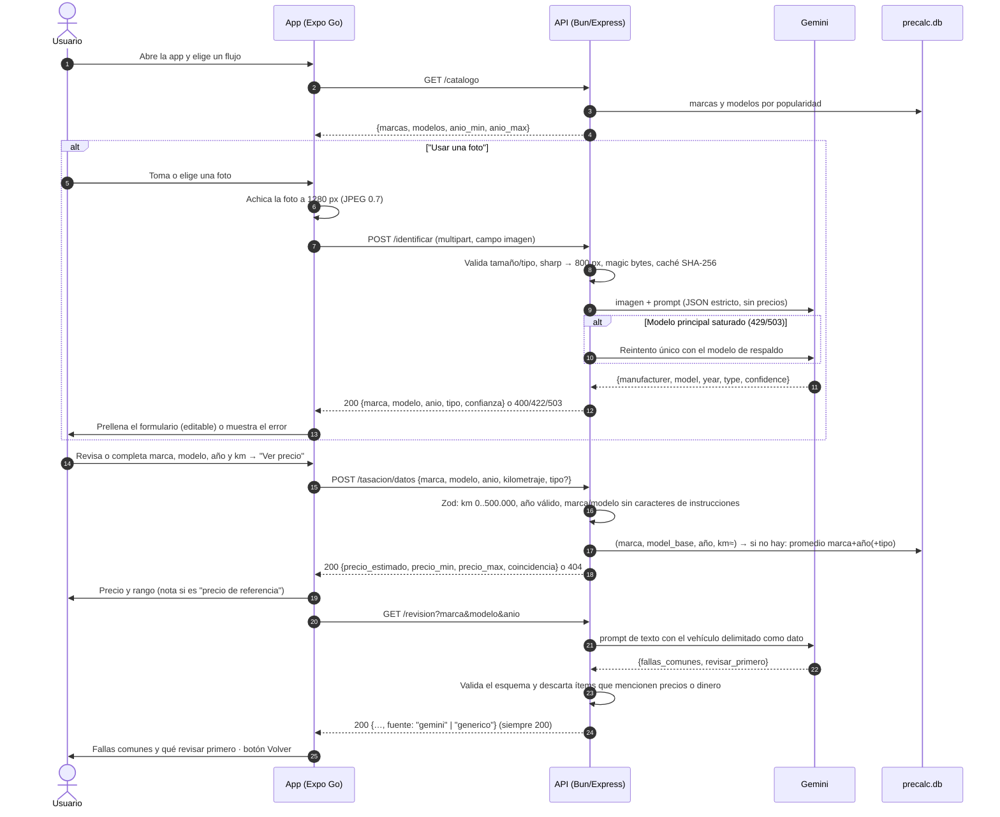
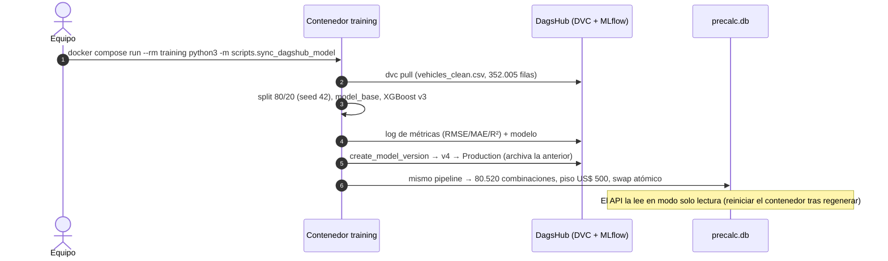

# Diagrama de Secuencia — Tasación de Autos con IA

Secuencia real del MVP (2026-10-26): los dos flujos de la app, el manejo de errores de Gemini y el pipeline que deja los precios precalculados. Para la vista de contenedores y componentes ver [`C4-ValorAuto.md`](C4-ValorAuto.md). Contratos: [`specs/tasacion`](../../openspec/changes/endpoint-tasacion-mvp/specs/tasacion/spec.md) y [`specs/app-tasacion`](../../openspec/changes/app-dos-flujos-tasacion/specs/app-tasacion/spec.md).

## Flujo 1 — Tasación desde la app

## Flujo 2 — Pipeline de ML (a demanda; el cron nocturno no está desplegado)

## Detalles

- **Tasación (síncrona):** el precio nunca lo calcula Gemini ni un modelo en vivo. Sale de `precalc.db` (ADR-0003, ADR-0004). Gemini solo identifica el auto y genera el texto de la revisión. Si falla, el usuario sigue con "Ingresar datos" y la revisión cae al checklist genérico.
- **Pipeline (asíncrono):** `scripts/nightly_retrain.py` está listo para correr cada noche (solo reentrena si cambió el hash del dataset), pero hoy no hay un servidor 24/7 que lo agende. Mientras tanto se ejecuta a demanda con el comando de arriba.
