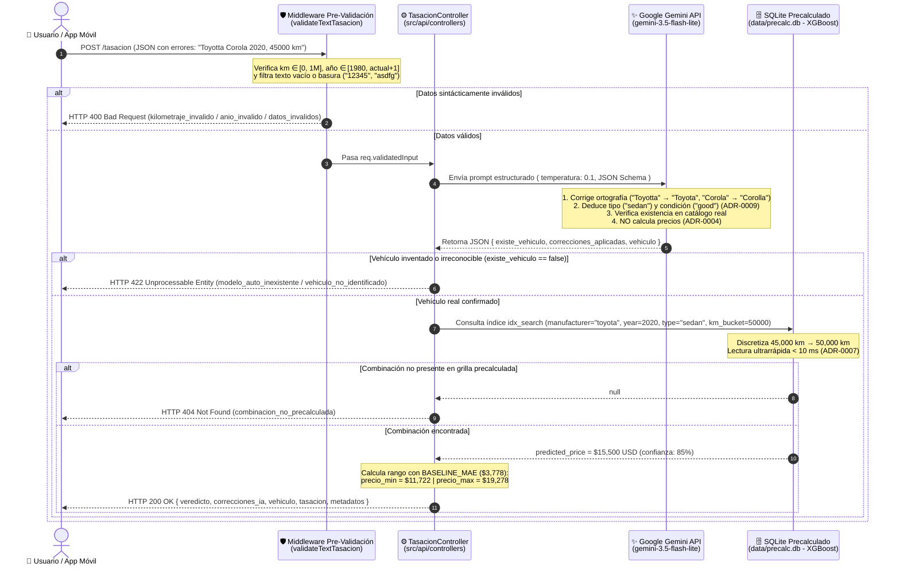

# 🚗 ValorAuto — Arquitectura e Implementación del Backend API REST (`src/api`)

**Documento Base para Diapositivas y Defensa Final**  
**Asignatura:** Taller de Sistemas Inteligentes  
**Responsable del Módulo Backend e Integración IA:** Samuel  
**Ubicación en el Repositorio:** [`src/api/`](file:///e:/VentaAuto/ValorAuto/src/api)  

---

## 1. Resumen Ejecutivo y Rol del Backend (Para Diapositiva de Introducción)

### 🎯 ¿Por qué el Backend actúa estrictamente como un Orquestador de Baja Latencia? (ADR-0001)
En sistemas inteligentes en producción, acoplar el entrenamiento o la inferencia pesada de Machine Learning directamente dentro del servidor web genera cuellos de botella de memoria RAM y bloquea el hilo de ejecución ante múltiples usuarios concurrentes.

Siguiendo el **[ADR-0001 (Backend Node.js/Bun con Express)](file:///e:/VentaAuto/ValorAuto/docs/adr/0001-backend-nodejs-express.md)**, el backend de **ValorAuto** fue diseñado bajo el patrón de **Orquestador Desacoplado de Baja Latencia**:
1. **Recibe y pre-valida** la solicitud del cliente móvil o web en menos de `1 ms`.
2. **Orquesta la capa cognitiva** mediante Google Gemini (`gemini-3.5-flash-lite` / `gemini-3.1-flash-lite`) para normalización semántica, corrección ortográfica y reconocimiento visual sin inventar precios.
3. **Resuelve la valoración económica** consultando en memoria/disco una matriz indexada en **SQLite (`data/precalc.db`)** precalculada por nuestro modelo **XGBoost**.

### 🛠️ Stack Tecnológico de Alto Rendimiento

| Componente | Tecnología Implementada | Rol en la Arquitectura (`src/api`) |
| :--- | :--- | :--- |
| **Runtime JS** | **Bun v1.4+** | Ejecutor ultrarrápido con arranque instantáneo, soporte nativo de ES Modules y test runner integrado (`bun test`). |
| **Framework Web** | **Express.js (ES Modules)** | Enrutamiento modular, cadena de middlewares de validación, seguridad HTTP y manejo centralizado de errores. |
| **Motor de Base de Datos** | **SQLite (`bun:sqlite` / `better-sqlite3`)** | Lectura indexada en modo solo-lectura sobre `data/precalc.db` con tiempos de consulta inferiores a `10 ms` (**ADR-0007**). |
| **SDK de Inteligencia Artificial** | **Google GenAI SDK (`@google/genai`)** | Integración oficial con **Google Gemini (`gemini-3.5-flash-lite`)** con salida estructurada (`application/json`) y baja temperatura (`0.1`). |
| **Seguridad y Observabilidad** | **Pino + Helmet + Express Rate Limit + Swagger** | Logs JSON estructurados, protección contra abuso de cuota, cabeceras seguras y documentación OpenAPI 3.0 en `/docs`. |

### ⚡ Ventaja Competitiva de la Arquitectura
- **Separación total del camino crítico:** El usuario obtiene su tasación completa en **menos de 3 segundos en total** (y **menos de 10–50 ms** en la consulta a la base de datos SQLite), mientras que el pipeline pesado de entrenamiento e inferencia masiva en Python (`scikit-learn` / `XGBoost`) se ejecuta de forma asíncrona/nocturna (**ADR-0003**) sin penalizar la experiencia del usuario.

---

## 2. Características Principales Implementadas (Para Diapositiva de Features)

### 🛡️ 2.1. Pre-validación Inteligente en Middleware (Ahorro de Cuota de IA)
Antes de realizar cualquier llamada externa a la API de Google Gemini, el middleware [`validateTextTasacion.middleware.js`](file:///e:/VentaAuto/ValorAuto/src/api/middlewares/validateTextTasacion.middleware.js) filtra en memoria entradas inválidas o malintencionadas:
- **Validación de Kilometraje:** Exige un número entero coherente en el rango $[0, 1,000,000]\text{ km}$. Valores negativos o excesivos se rechazan inmediatamente con `400 kilometraje_invalido`.
- **Validación de Año:** Verifica que el año de fabricación se encuentre entre `1980` y el `año actual + 1`. Años irreales (ej. `1950` o `2035`) devuelven `400 anio_invalido`.
- **Filtro Anti-Basura (*Anti-Gibberish*):** Detecta y bloquea entradas vacías, cadenas compuestas únicamente por números (`"12345"`), símbolos (`"???"`), secuencias de teclado (`"asdfg"`, `"qwerty"`) o caracteres repetidos (`"aaaaa"`), respondiendo `400 datos_invalidos` sin gastar tokens ni cuota de Gemini.

### 🧠 2.2. Integración con Google Gemini (`gemini-3.5-flash-lite`) — ADR-0004
El servicio [`gemini.service.js`](file:///e:/VentaAuto/ValorAuto/src/api/services/gemini.service.js) actúa como un **normalizador semántico y clasificador**, tanto para entradas de texto (`POST /tasacion`) como para fotografías (`POST /tasacion/imagen`):
- **Corrección Ortográfica Automática:** Transforma errores de digitación del usuario (ej. *"Toyotta Corola"* $\rightarrow$ *"Toyota Corolla"*, *"Chebrolet"* $\rightarrow$ *"Chevrolet"*) y documenta cada ajuste en el arreglo `correcciones_ia` / `correcciones_aplicadas`.
- **Reubicación de Datos Desordenados:** Si el usuario invierte marca y modelo o envía una frase libre en el campo `texto` (ej. `"Toyotta Corola 2020 sedan con 45000 km"`), Gemini extrae y posiciona cada atributo en su propiedad canónica.
- **Deducción de Atributos Faltantes (ADR-0009):** Si el usuario omite el tipo de carrocería (`type`) o el estado estético (`condition`), la IA deduce el tipo oficial del vehículo según el catálogo real (ej. *Toyota Corolla* $\rightarrow$ `"sedan"`, *Toyota RAV4* $\rightarrow$ `"suv"`, *Ford F-150* $\rightarrow$ `"truck"`) y asigna el estado canónico (`"good"` por defecto).
- **Verificación de Catálogo Automotriz Real:** Comprueba si la combinación de marca y modelo existe realmente en la industria automotriz.
  - Si el usuario ingresa un vehículo inventado (ej. *"Toyota Pepito"* o *"Ford Pikachu"*), la IA marca `existe_vehiculo: false` y el backend rechaza la petición con **`422 Unprocessable Entity`** (`modelo_auto_inexistente` / `vehiculo_no_identificado`).
  - Si los datos o la imagen son ilegibles o irreconocibles, responde **`422`** (`datos_irreconocibles` / `vehiculo_no_identificado`).
- **Regla de Oro de MLOps ([ADR-0004](file:///e:/VentaAuto/ValorAuto/docs/adr/0004-gemini-vision-vs-modelo-propio.md)):**
  > **Prohibición estricta a Gemini de calcular o sugerir precios.** Los LLMs sufren de alucinaciones numéricas y desconocen la depreciación local entrenada. En ValorAuto, Gemini solo identifica y normaliza el vehículo; **el 100% del precio proviene de nuestro modelo propio de Machine Learning (XGBoost)**.

### ⚡ 2.3. Consulta Ultrarrápida en SQLite y Precálculo — ADR-0003, ADR-0007 y ADR-0009
El servicio [`sqlite.service.js`](file:///e:/VentaAuto/ValorAuto/src/api/services/sqlite.service.js) conecta con [`data/precalc.db`](file:///e:/VentaAuto/ValorAuto/data/precalc.db) (53,280 combinaciones precalculadas indexadas mediante `idx_search`):
- **Discretización Matemática del Kilometraje:** Cualquier kilometraje ingresado por el usuario se proyecta mediante distancia absoluta mínima $\min |k - r_i|$ hacia los 5 rangos oficiales precalculados:
  $$\text{Grilla de Kilometraje} = \{10000,\ 50000,\ 100000,\ 150000,\ 200000\}\text{ km}$$
  *(Ejemplo: `45,000 km` se discretiza automáticamente al bucket `50000`).*
- **Cálculo Dinámico de Rango de Mercado con el MAE:** A partir del `predicted_price` precalculado por el modelo XGBoost, el backend calcula el intervalo de negociación utilizando el Error Absoluto Medio oficial del modelo en producción (`BASELINE_MAE = 3778 USD`):
  $$\text{precio\_min} = \max(500,\ \text{precio\_estimado} - 3778)$$
  $$\text{precio\_max} = \text{precio\_estimado} + 3778$$
- **Recarga Atómica en Caliente (*Hot-Reload*):** El servicio monitorea el `mtimeMs` del archivo `data/precalc.db`; cuando el pipeline nocturno de Python reemplaza la base de datos mediante `os.replace`, el backend recarga la conexión automáticamente sin reiniciar el servidor ni perder peticiones.

### 🔒 2.4. Seguridad, Resiliencia y Observabilidad
- **Manejo Inteligente de Errores de IA:** Si Gemini responde con `400 INVALID_ARGUMENT`, el servicio **aborta inmediatamente sin reintentar** y devuelve un error claro al cliente. Solo aplica reintentos/failover ante errores transitorios de red o saturación (`429 Too Many Requests` o `503 Service Unavailable`).
- **Control de Timeouts (`VISION_TIMEOUT_MS`):** Límite estricto con `Promise.race` para evitar peticiones colgadas.
- **Caching en Memoria (`cacheService.js`):** Caché LRU tanto por clave de texto normalizado como por hash criptográfico `SHA-256` de imágenes, reduciendo a `< 2 ms` las consultas repetidas.
- **Protección y Trazabilidad:** Rate Limiting de `10 peticiones/minuto` por IP, cabeceras de seguridad `Helmet`, `CORS` habilitado para la app móvil en React Native/Expo, logs estructurados con `pino` y documentación viva en `/docs`.

---

## 3. Flujo de Funcionamiento Paso a Paso (Diagrama Mermaid para Diapositiva de Arquitectura)



---

## 4. Guía Completa de la API REST (Contratos, Endpoints y Ejemplos)

### 4.1. `GET /health` — Diagnóstico de Salud y Métricas en Tiempo Real
Permite verificar en vivo el estado de conexión con SQLite (`data/precalc.db`), el total de combinaciones precalculadas cargadas, el modelo de Gemini activo, las estadísticas de caché y el consumo de memoria RAM del contenedor/proceso Bun.

- **Método y Ruta:** `GET http://localhost:3000/health`
- **Ejemplo de Respuesta (`200 OK`):**
```json
{
  "status": "OK",
  "timestamp": "2026-10-26T18:15:00.000Z",
  "service": "ValorAuto REST API",
  "uptimeSeconds": 142.5,
  "runtime": "Bun v1.4.2",
  "database": {
    "status": "connected",
    "path": "E:\\VentaAuto\\ValorAuto\\data\\precalc.db",
    "totalRecords": 53280,
    "responseTimeMs": 0.48
  },
  "geminiApi": {
    "configured": true,
    "maskedKey": "AQ.Ab8RN...piTQ",
    "model": "gemini-3.5-flash-lite"
  },
  "cache": {
    "size": 12,
    "maxItems": 500,
    "hits": 8,
    "misses": 12,
    "hitRate": "40.0%"
  },
  "memory": {
    "rssMb": 68.4,
    "heapUsedMb": 24.1,
    "heapTotalMb": 38.0
  }
}
```

---

### 4.2. `GET /docs` — Documentación Interactiva OpenAPI 3.0 (Swagger UI)
- **Método y Ruta:** `GET http://localhost:3000/docs` (y especificación JSON en `GET http://localhost:3000/docs.json`).
- **Propósito:** Provee un entorno visual interactivo donde el docente o cualquier desarrollador puede probar en vivo tanto la **Tasación por Texto (`POST /tasacion`)** como la **Tasación por Imagen (`POST /tasacion/imagen`)** usando el botón *"Try it out"*.

---

### 4.3. `POST /tasacion` — Tasación Inteligente de Vehículo por Texto (JSON)

#### 📋 Headers Requeridos
```http
Content-Type: application/json
Accept: application/json
```

#### 📥 Estructura del Body JSON de Entrada
El endpoint soporta tanto una descripción libre en el campo `texto` como el envío de atributos individuales detallados:

| Campo | Tipo | Requerido | Restricciones / Valores Permitidos | Descripción |
| :--- | :---: | :---: | :--- | :--- |
| **`texto`** | `string` | Condicional* | Mínimo 2 caracteres, no basura | Descripción libre del auto (ej. `"Toyotta Corola 2020 con 45000 km"`). *Obligatorio si no se envían `marca` y `modelo`.* |
| **`marca`** | `string` | Condicional* | Mínimo 2 caracteres (ej. `"Toyota"`, `"Ford"`) | Marca del fabricante (tolera errores ortográficos y alias como `"VW"` o `"Chevy"`). |
| **`modelo`** | `string` | Condicional* | Mínimo 2 caracteres (ej. `"Corolla"`, `"Civic"`) | Nombre del modelo del vehículo. |
| **`anio`** | `integer` | Opcional | `1980` a `2027` (`actual + 1`) | Año de fabricación. Si se omite, se extrae de `texto` o se infiere el año representativo. |
| **`kilometraje`** | `integer` | Condicional* | Entero entre `0` y `1,000,000` | Kilometraje recorrido en km (también acepta el alias `"odometer"`). |
| **`tipo`** | `string` | Opcional | `sedan`, `suv`, `truck`, `hatchback`, `coupe`, `wagon`, `van`, `pickup`, `convertible`, `other` | Tipo de carrocería (**ADR-0009**). Si se omite, Gemini lo deduce automáticamente según el modelo. |
| **`estado_estetico`** | `string` | Opcional | `new`, `like new`, `excellent`, `good`, `fair`, `salvage` | Condición estética del vehículo (**ADR-0009**). Acepta valores en español (`"excelente"`, `"bueno"`). Por defecto `"good"`. |

#### 💻 Ejemplo Real de Petición (con errores ortográficos intencionales)

**Opción A — Usando `cURL` en consola:**
```bash
curl -X POST http://localhost:3000/tasacion \
  -H "Content-Type: application/json" \
  -d '{
    "marca": "Toyotta",
    "modelo": "Corola",
    "anio": 2020,
    "kilometraje": 45000,
    "tipo": "sedán",
    "estado_estetico": "buen estado"
  }'
```

**Opción B — Usando el campo unificado `texto` (JSON):**
```json
{
  "texto": "Toyotta Corola 2020 con 45000 km en buen estado",
  "kilometraje": 45000
}
```

#### ✅ Ejemplo Real de Respuesta Exitosa (`200 OK`)
```json
{
  "success": true,
  "veredicto": "vehiculo_valido_y_tasado",
  "correcciones_ia": [
    "Se corrigió la ortografía de la marca 'Toyotta' a 'Toyota'",
    "Se corrigió la ortografía del modelo 'Corola' a 'Corolla'",
    "Se estandarizó el tipo de carrocería 'sedán' a 'sedan'",
    "Se mapeó el estado estético 'buen estado' a 'good'"
  ],
  "vehiculo": {
    "marca": "Toyota",
    "modelo": "Corolla",
    "anio": 2020,
    "kilometraje": 45000,
    "tipo": "sedan",
    "estado_estetico": "good"
  },
  "tasacion": {
    "precio_estimado": 15500,
    "precio_min": 11722,
    "precio_max": 19278,
    "moneda": "USD",
    "confianza": 0.85,
    "confianza_porcentaje": "85%",
    "origen_precio": "modelo_ml"
  },
  "metadatos": {
    "tiempo_respuesta_ms": 2975.78,
    "nota": "Precio calculado exitosamente con el modelo ML local.",
    "confianza_normalizacion": 0.98,
    "correcciones_aplicadas": [
      "Se corrigió la ortografía de la marca 'Toyotta' a 'Toyota'",
      "Se corrigió la ortografía del modelo 'Corola' a 'Corolla'",
      "Se estandarizó el tipo de carrocería 'sedán' a 'sedan'",
      "Se mapeó el estado estético 'buen estado' a 'good'"
    ],
    "rango_km_consultado": 50000,
    "cache_hit": false,
    "desglose_tiempos_ms": {
      "gemini_ms": 2966.16,
      "pricing_ms": 8.25
    }
  }
}
```

---

### 4.4. `POST /tasacion/imagen` — Tasación Basada en Fotografía (Gemini Vision)

- **Headers Requeridos:** `Content-Type: multipart/form-data`
- **Campos del Formulario (`form-data`):**
  - `imagen` *(file, requerido)*: Fotografía del vehículo en formato `JPG`, `PNG` o `WEBP` (máximo `8 MB`).
  - `kilometraje` *(integer, opcional)*: Kilometraje actual del auto entre `0` y `1,000,000` (por defecto `50,000 km`).
- **Ejemplo de Petición `cURL`:**
```bash
curl -X POST http://localhost:3000/tasacion/imagen \
  -F "imagen=@src/api/tests/fixtures/car_1_toyota.jpg" \
  -F "kilometraje=45000"
```

---

## 5. Catálogo de Manejo de Errores y Códigos HTTP (Tabla para Diapositiva de Calidad/QA)

| Código HTTP | Código de Error Interno (`error`) | Causa / Escenario de Disparo | Ejemplo de Mensaje Devuelto al Cliente |
| :---: | :--- | :--- | :--- |
| **`200 OK`** | N/A (`veredicto: "vehiculo_valido_y_tasado"`) | El vehículo fue validado, normalizado por Gemini y tasado con éxito en SQLite. | `"Precio calculado exitosamente con el modelo ML local."` |
| **`400 Bad Request`** | `kilometraje_invalido` | El kilometraje falta, no es numérico, es negativo (`< 0`) o supera `1,000,000 km`. | `"El kilometraje debe ser un número entero entre 0 y 1,000,000."` |
| **`400 Bad Request`** | `anio_invalido` | El año ingresado es menor a `1980` o mayor al año actual + 1. | `"El año ingresado está fuera de rango (1980 - actual)."` |
| **`400 Bad Request`** | `datos_invalidos` | Marca, modelo o texto vacíos, con solo números (`"12345"`), símbolos (`"???"`) o tipeo aleatorio (`"asdfg"`). | `"Por favor ingresa una marca y modelo válidos antes de procesar."` |
| **`400 Bad Request`** | `imagen_invalida` / `INVALID_ARGUMENT` | No se adjuntó imagen, supera los `8 MB`, el `mimeType` no es JPG/PNG/WEBP o Gemini devolvió `400 INVALID_ARGUMENT` (sin reintentos). | `"No se ha proporcionado ninguna imagen del vehículo en el campo 'imagen'."` |
| **`422 Unprocessable Entity`** | `modelo_auto_inexistente` / `vehiculo_no_identificado` | El usuario ingresó una marca o modelo ficticio que no existe en el mercado real (ej. *"Toyota Pepito"*). | `"El modelo 'Pepito' no corresponde a ningún vehículo comercial fabricado por Toyota."` |
| **`422 Unprocessable Entity`** | `datos_irreconocibles` / `vision_format_error` | El texto o la fotografía no corresponden a un automóvil o la confianza de identificación es menor al umbral mínimo (`< 0.60`). | `"No se pudo identificar un vehículo válido o la confianza es insuficiente."` |
| **`404 Not Found`** | `combinacion_no_precalculada` | El vehículo sí existe en el mundo real (ej. un superdeportivo exótico), pero su combinación no figura en la grilla precalculada de `data/precalc.db` (**ADR-0003**). | `"No se encontró una tasación precalculada para Ferrari F8 (2024)."` |
| **`429 Too Many Requests`** | `limite_excedido` | Un cliente superó el límite de seguridad de `10 peticiones por minuto` (Rate Limiting). | `"Demasiadas solicitudes de tasación desde esta IP. Intenta nuevamente en 1 minuto."` |
| **`503 Service Unavailable`** | `vision_no_disponible` | Timeout superado (`VISION_TIMEOUT_MS`), falta de `GEMINI_API_KEY` o caída temporal del servicio de Google Gemini. | `"Tiempo de espera agotado al consultar el servicio de Gemini."` |
| **`500 Internal Server Error`** | `error_interno` | Excepción interna no controlada en el servidor. | `"Ocurrió un error inesperado al procesar la tasación."` |

---

## 6. Pruebas Automatizadas (`bun test`) y Guion Breve de Exposición para Samuel

### 🧪 6.1. Suite de Pruebas Automatizadas en Bun (`36 Pass, 0 Fail`)
El backend cuenta con una suite de **36 pruebas unitarias y de integración** ejecutadas con el runner nativo de Bun ([`src/api/test/tasacion.test.js`](file:///e:/VentaAuto/ValorAuto/src/api/test/tasacion.test.js) y [`src/api/test/pricingService.test.js`](file:///e:/VentaAuto/ValorAuto/src/api/test/pricingService.test.js)) que validan todo el sistema en **`~1 segundo`**:

```bash
bun test src/api/test/tasacion.test.js src/api/test/pricingService.test.js
```

**Cobertura verificada por la suite:**
1. **Normalización y Fuzzy Matching (`normalizer.js`):** Limpieza de diacríticos, resolución de alias (`"VW"` $\rightarrow$ `"volkswagen"`, `"Chevy"` $\rightarrow$ `"chevrolet"`), homologación de carrocerías y estados estéticos (**ADR-0009**) y tolerancia a errores tipográficos con `Fuse.js`.
2. **Caché Criptográfico (`cacheService.js`):** Generación determinista de hashes `SHA-256` y métricas de `HIT`/`MISS`.
3. **Motor SQLite (`sqlite.service.js`):** Discretización exacta hacia los 5 buckets de kilometraje, cálculo de intervalos `precio_min`/`precio_max` con `BASELINE_MAE`, modo estricto **ADR-0003** (`null` $\rightarrow$ `404`) y recarga atómica en caliente (*hot-reload*).
4. **Servicio Gemini (`gemini.service.js`):** Limpieza de prefijos `data:image/...;base64,`, validación estricta de `mimeType`, **no-reintento ante errores `400 INVALID_ARGUMENT`** (`attempts === 1`) y **reintento automático ante errores `503/429`** (`attempts === 2`).
5. **Contratos HTTP Integrales:** Verificación de códigos `200`, `400`, `404`, `422`, `429` (Rate Limit) y endpoints de observabilidad (`/health`, `/docs`, `/docs.json`).

---

### 🎤 Puntos Clave para Decir en la Exposición (Guion para Samuel)

- **📌 Diapositiva 1 (El Rol del Backend como Orquestador - ADR-0001):**
  > *"Mi responsabilidad fue diseñar e implementar la API REST en `src/api` usando **Bun y Express**. En lugar de meter el modelo pesado de Python dentro del servidor web —lo cual saturaría la memoria RAM con pocas peticiones—, diseñamos el backend como un **Orquestador de Baja Latencia**: valida en menos de 1 milisegundo, usa Gemini como capa lingüística/visual y consulta los precios precalculados en SQLite en menos de 10 milisegundos."*

- **📌 Diapositiva 2 (Pre-validación e Inteligencia Artificial Responsable - ADR-0004):**
  > *"Implementamos un filtro inteligente antes de llamar a la IA: si alguien envía kilometrajes negativos, años fuera de rango o texto basura como `'asdfg'` o `'12345'`, nuestro middleware lo bloquea en el acto con un error `400` sin gastar nuestra cuota de API. Cuando los datos pasan a Gemini, la IA corrige errores ortográficos como `'Toyotta Corola'`, deduce el tipo de carrocería y verifica que el auto exista en la vida real; si inventan un `'Toyota Pepito'`, devolvemos un `422`."*

- **📌 Diapositiva 3 (¿Por qué Gemini NO calcula el precio? - Pregunta Clave del Docente):**
  > *"Si el docente pregunta: **'¿Por qué no le pidieron directamente el precio a Gemini?'**, la respuesta técnica (ADR-0004) es que los modelos de lenguaje alucinan con cifras financieras y no conocen la distribución real de nuestro dataset. Por eso aplicamos una regla estricta de MLOps: **Gemini tiene prohibido estimar precios**. Gemini únicamente estructura y valida la entrada; el precio proviene 100% de nuestro modelo **XGBoost** entrenado con datos reales, acotado con un rango mínimo y máximo basado en nuestro Error Absoluto Medio (`MAE = $3,778 USD`)."*

- **📌 Diapositiva 4 (¿Por qué no ejecutamos Python en vivo desde Express? - Pregunta Clave del Docente):**
  > *"Si preguntan: **'¿Por qué usan SQLite precalculado (`data/precalc.db`) en vez de levantar un subproceso de Python en cada petición?'**, la respuesta (ADR-0003 y ADR-0007) es por rendimiento y escalabilidad: levantar Python y cargar `scikit-learn`/`XGBoost` por petición tarda varios segundos y consume cientos de megabytes de RAM. Con el precálculo nocturno exportado a SQLite con índices compuestos y discretización de kilometraje, reducimos el tiempo de consulta del precio de segundos a **menos de 10 milisegundos**, soportando recarga en caliente sin apagar la API."*

- **📌 Diapositiva 5 (Calidad, Resiliencia y Pruebas Automatizadas):**
  > *"Finalmente, blindamos el backend para producción: limpiamos los buffers Base64, validamos los `mimeTypes` binarios, evitamos reintentos inútiles cuando hay errores de cliente `400 INVALID_ARGUMENT` (reintentando solo en errores `429` o `503`), documentamos los endpoints en vivo con **Swagger UI (`/docs`)** y respaldamos toda la arquitectura con **36 pruebas automatizadas en `bun test`** que se ejecutan en 1 segundo con 0 fallos."*
