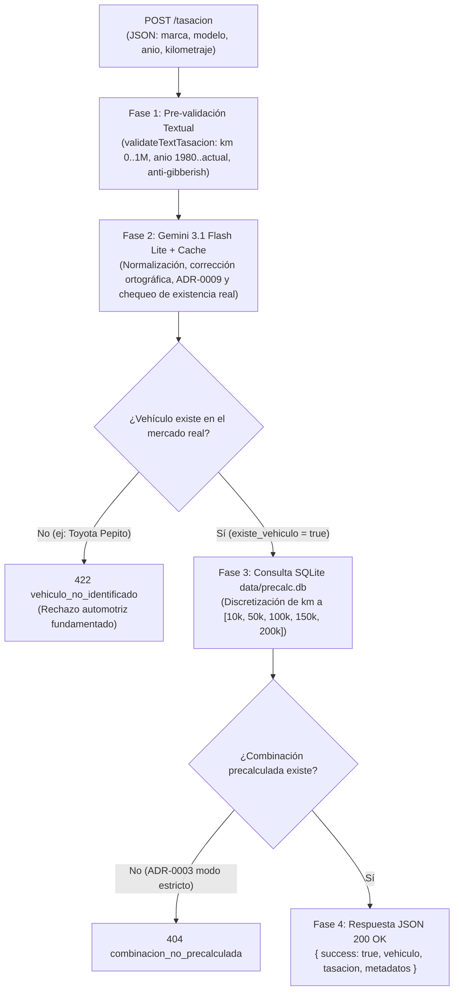

# ValorAuto Backend REST API — Pipeline de Valoración Textual y Precalculado (v2.1)

API REST de alto rendimiento construida en **Express** sobre el runtime ultra-rápido **Bun** para el proyecto **ValorAuto** (Tasador Inteligente de Vehículos con IA y Machine Learning).

Esta versión implementa un **Pipeline de Valoración en 4 Fases** que recibe datos automotrices en formato JSON (`application/json`), aplica pre-validación sintáctica temprana, normaliza y corrige ortografía y verifica existencia con **Google Gemini** (`gemini-3.1-flash-lite` con cuota de 500 RPD), y consulta los precios precalculados en **SQLite** (`data/precalc.db`, **ADR-0003** y **ADR-0007**), asegurando estricto cumplimiento del **ADR-0004** (la IA no calcula ni estima precios).

---

## 🔄 Flujo del Pipeline (`POST /tasacion` en JSON)



### Detalle de las 4 Fases:

1. **Fase 1: Pre-validación Sintáctica y Anti-Basura ([`validateTextTasacion.middleware.js`](middlewares/validateTextTasacion.middleware.js))**
   - Recibe payload plano o anidado en `{ "vehiculo": { ... } }` con claves en español o inglés (`marca`/`manufacturer`, `modelo`/`model`, `anio`/`year`, `kilometraje`/`odometer`).
   - Valida `kilometraje` (0 a 1,000,000 km) $\rightarrow$ `400 kilometraje_invalido`.
   - Valida `anio` (1980 a año actual + 1) $\rightarrow$ `400 anio_invalido`.
   - Rechaza cadenas de texto basura (`"12345"`, `"???"`, `"asdfg"`, caracteres repetidos) $\rightarrow$ `400 datos_invalidos`.

2. **Fase 2: Normalización Semántica y Existencia con Gemini ([`gemini.service.js`](services/gemini.service.js))**
   - Emplea **`gemini-3.1-flash-lite`** (cuota de 500 RPD / 15 RPM, respuesta en 2-4 segundos).
   - Corrige ortografía (ej: `"Toyotta Corola"` $\rightarrow$ `"Toyota Corolla"`).
   - Reubica campos mal posicionados y asigna tipos de carrocería y estados estéticos según categorías canónicas (**ADR-0009**).
   - Si el vehículo es ficticio o inexistente, retorna `existe_vehiculo: false` $\rightarrow$ `422 vehiculo_no_identificado`.
   - **ADR-0004:** La IA tiene estrictamente prohibido generar o estimar precios.

3. **Fase 3: Consulta al Modelo ML Precalculado ([`sqlite.service.js`](services/sqlite.service.js))**
   - Consulta la base SQLite `data/precalc.db` (`precalculated_prices`).
   - Discretiza el kilometraje al bucket más cercano (`[10000, 50000, 100000, 150000, 200000]`).
   - Calcula rango de precio mínimo y máximo en base al $\text{MAE} = \$3,778\text{ USD}$.
   - Si la combinación no existe en la base precalculada, responde `404 combinacion_no_precalculada` (**ADR-0003**).

4. **Fase 4: Estructura Estándar de Respuesta JSON ([`tasacion.controller.js`](controllers/tasacion.controller.js))**
   ```json
   {
     "success": true,
     "vehiculo": {
       "marca": "Toyota",
       "modelo": "Corolla",
       "anio": 2020,
       "kilometraje": 45000,
       "tipo": "sedan",
       "estado_estetico": "good"
     },
     "tasacion": {
       "precio_estimado": 15500,
       "precio_min": 11722,
       "precio_max": 19278,
       "moneda": "USD",
       "confianza": 0.85,
       "confianza_porcentaje": "85%",
       "origen_precio": "modelo_ml"
     },
     "metadatos": {
       "tiempo_respuesta_ms": 2975.78,
       "nota": "Precio calculado exitosamente con el modelo ML local.",
       "confianza_normalizacion": 0.98,
       "correcciones_aplicadas": [
         "Se corrigió la ortografía de la marca 'Toyotta' a 'Toyota'",
         "Se corrigió la ortografía del modelo 'Corola' a 'Corolla'"
       ],
       "rango_km_consultado": 50000,
       "cache_hit": false
     }
   }
   ```

---

## 🛠️ Comandos de Ejecución con Bun

```bash
# 1. Instalar dependencias
cd src/api
bun install

# 2. Levantar servidor en modo desarrollo (--watch)
bun run dev

# 3. Ejecutar la suite completa de 30 pruebas unitarias e integración
bun test

# 4. Probar endpoint POST /tasacion con cURL
curl -X POST http://localhost:3000/tasacion \
  -H "Content-Type: application/json" \
  -d '{
    "marca": "Toyotta",
    "modelo": "Corola",
    "anio": 2020,
    "kilometraje": 45000
  }'

# 5. Repoblar la base de datos SQLite precalculada de prueba (53,280 combinaciones)
bun run seed
```

---

## 📖 Endpoints Disponibles

| Método | Ruta | Descripción |
| :--- | :--- | :--- |
| **`POST`** | `/tasacion` | Tasación textual JSON en 4 fases (Pre-validación + Gemini 3.1 + SQLite precalc). |
| **`GET`** | `/health` | Diagnóstico de salud (estado SQLite, modelo Gemini activo, clave enmascarada, caché LRU, RAM). |
| **`GET`** | `/docs` | Documentación interactiva Swagger UI (OpenAPI 3.0.3). |
| **`GET`** | `/docs.json` | Especificación OpenAPI 3.0.3 en formato JSON puro. |
